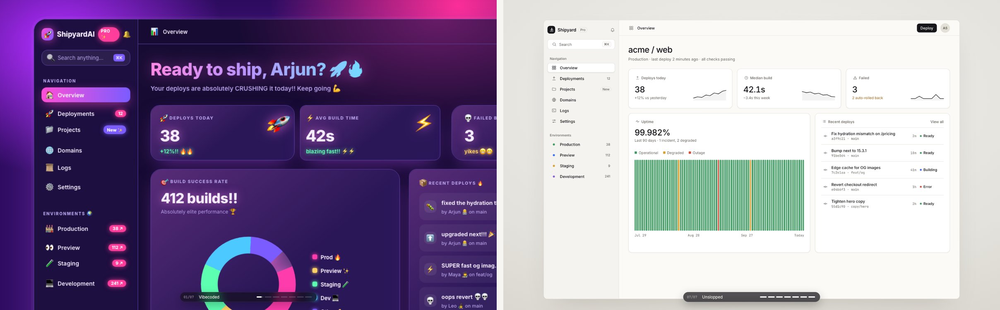

# unslop

An agent skill that turns vibecoded UIs into calm, honest ones. It measures first, fixes spacing, surfaces, icons, type and data in five passes, and stops when its own audit comes back clean.

**[Website and live demo](https://arjunkshah12345-hash.github.io/unslop/)** · [The rules](skills/unslop/references/rules.md) · [SKILL.md](skills/unslop/SKILL.md)



## Install

```sh
npx skills add arjunkshah12345-hash/unslop
```

Or by hand for Claude Code:

```sh
git clone https://github.com/arjunkshah12345-hash/unslop
ln -s "$PWD/unslop/skills/unslop" ~/.claude/skills/unslop
```

For any other agent, copy `skills/unslop` to wherever it loads skills. Then ask it to "unslop this dashboard".

## The five passes

Always in this order. Spacing first, because it is structural and hard to see once colour changes. Data last, because it depends on every decision before it.

| Pass | Principle | Slop | Unslopped |
|---|---|---|---|
| 1. Spacing | Measure, then snap to a 4pt scale | gaps of 9, 3, 14, 6, 11 | 4, 4, 4, 4, 4 |
| 2. Surfaces | Calm the colour | purple-pink gradient, neon glow | one neutral ramp, one accent |
| 3. Icons | Real icons, not emoji | emoji in nav and status | one line icon set, `currentColor` |
| 4. Type | Honest type | "Deploy now", "blazing fast!!" with emoji | "Deploy", "−3.4s this week" |
| 5. Data | Data that reads | spinning donut, "94%!!" | sparklines, 90-day uptime, context |

Every rule, with the reason for it and how it is checked, is in [references/rules.md](skills/unslop/references/rules.md).

## The audit

[`audit.js`](skills/unslop/scripts/audit.js) is a read-only script with no dependencies. It finds the measurable tells and returns a report.

```sh
npm i && npx playwright install chromium
npm run audit -- https://your-app.local/dashboard          # exits 1 while errors remain
npm run audit -- https://your-app.local/dashboard --json   # full report
```

You can also evaluate the file with any agent's browser tool (the completion value is the report) or paste it into DevTools. Add `data-unslop-ignore` to skip a subtree, such as a deliberate "before" example.

| Check | Severity |
|---|---|
| `spacing/off-grid`, `spacing/uneven-siblings`, `icons/emoji`, `surface/gradient-text`, `contrast/text` | error |
| `surface/colored-glow`, `surface/text-glow`, `surface/vivid-gradient`, `surface/too-many-accents`, `type/exclamation`, `type/hype`, `type/too-many-weights`, `type/too-many-sizes`, `radius/no-scale`, `motion/infinite` | warning |
| `surface/glass`, `type/proportional-figures` | info |

On the demo dashboard it goes from 106 errors and 76 warnings to 0. The website passes it too: there is a button on the page that runs it live.

Limitations: contrast is measured against the nearest opaque ancestor background, so text over images or sibling backdrops needs a manual check. Rendered gaps are measured in screen pixels, so CSS transforms scale them.

## The demo

[`skills/unslop/assets/before-after.html`](skills/unslop/assets/before-after.html) is a single HTML file with no dependencies. It animates Shipyard, a made-up deploy dashboard, through the five passes: redlines are measured live from the DOM and snap to the scale, `@property`-registered colour tokens interpolate the theme, emoji become line icons, copy and charts are rewritten. The skill uses it as a template when you ask for a before/after film of your own UI.

URL options: `?stage=N` starts at pass N, `&hold` stops at the end of it, `&embed` hides the captions. Keys: space pauses, arrows step, `r` restarts.

## Layout

```
skills/unslop/
  SKILL.md                 the skill
  references/rules.md      the rulebook
  scripts/audit.js         the audit (browser)
  scripts/audit-url.mjs    the audit (Node + Playwright)
  assets/before-after.html the demo and film template
docs/                      the website (GitHub Pages)
```

`npm run sync` copies the audit and the demo into `docs/` after you change them.

## Credit

The idea comes from Damir Sokolovsky's [Unslopping a vibecoded dashboard](https://x.com/heydamir/status/2115063463063998736). Everything here was written from scratch.

MIT licensed.
